# Electric Blue × Deep Violet · prototype

<picture>
  <source media="(max-width: 600px)" srcset="assets/hero-mobile.svg">
  
</picture>

## Selected work

<a href="https://github.com/ducdanh2304/lexviet-retrieval"><picture>
  <source media="(max-width: 600px)" srcset="assets/lexviet-mobile.svg">
  
</picture></a>
