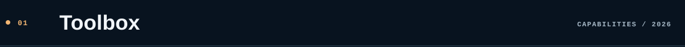
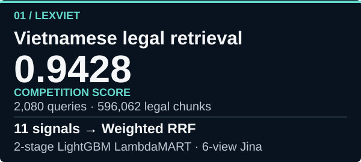
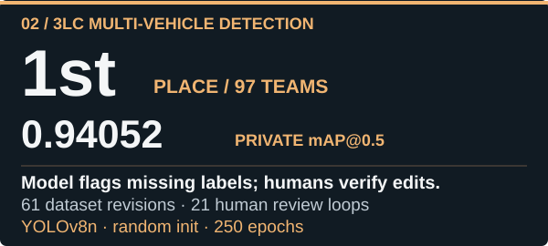
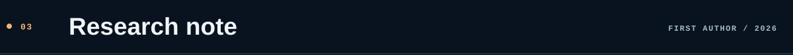

  
  
  
  
  

<strong>Vision → language → retrieval.</strong> I work on the data, models and evaluation that turn a promising result into a usable system.

<table>
<tr><th align="left">01 / Programming</th><td> <strong>Python</strong> &nbsp;  <strong>SQL</strong> &nbsp;  <strong>Bash</strong></td></tr>
<tr><th align="left">02 / Machine learning</th><td> <strong>PyTorch</strong> &nbsp; 🤗 <strong>Transformers</strong> &nbsp;  <strong>Scikit-learn</strong> &nbsp; <strong>LightGBM · YOLO · PEFT / LoRA / QLoRA</strong></td></tr>
<tr><th align="left">03 / Vision &amp; NLP</th><td> <strong>OpenCV</strong> &nbsp; <strong>Object detection · OCR · Information retrieval · Dense retrieval · Reranking</strong></td></tr>
<tr><th align="left">04 / Data &amp; engineering</th><td> <strong>NumPy</strong> &nbsp;  <strong>Pandas</strong> &nbsp;  <strong>SQLite</strong> &nbsp;  <strong>Git</strong> &nbsp;  <strong>Linux</strong></td></tr>
<tr><th align="left">05 / Delivery</th><td> <strong>FastAPI</strong> &nbsp;  <strong>Docker</strong> &nbsp;  <strong>GitHub Actions</strong> &nbsp; <strong>ONNX · TensorRT</strong></td></tr>
</table>

**LexViet** · Vietnamese legal document retrieval across 596,062 chunks. Eleven search signals feed weighted fusion, LightGBM ranking and Jina reranking. **[Explore repository ↗](https://github.com/ducdanh2304/lexviet-retrieval)**

**Multi-Vehicle Detection** · Label auditing and YOLOv8n training from scratch, followed by confidence and NMS tuning. **[Explore repository ↗](https://github.com/ducdanh2304/3lc-vehicle-detection-1st-place)**

**Multimodal Video Retrieval** · First-author research combining visual embeddings, captions, speech and temporal alignment for Vietnamese search. **[Read the paper ↗](https://link.springer.com/chapter/10.1007/978-981-92-2597-2_36)**

> **Efficient Video Retrieval for Less-Resourced Languages via Multi-Modal Semantic Search.**  
> **First Author · 2026 · [Springer Nature ↗](https://link.springer.com/chapter/10.1007/978-981-92-2597-2_36)**  
> A multilingual retrieval framework that aligns video keyframes, language-adaptive captions and natural-language queries. The research addresses semantic and temporal search over large Vietnamese video collections.

1st Place — <a href="https://www.kaggle.com/competitions/3-lc-multi-vehicle-detection-challenge">3LC Multi-Vehicle Detection</a> · Top 19 — UIT Data Science Challenge, Legal Information Retrieval · Top 5 / Consolation Prize — Ho Chi Minh City AI Challenge 2025, among 600+ teams.

<strong>Let’s make the signal useful.</strong> <a href="mailto:danhnd.work@gmail.com">Email</a> · <a href="https://www.linkedin.com/in/danh-nguyen-duc-79ba6432a/">LinkedIn</a> · <a href="https://github.com/ducdanh2304?tab=repositories">Repositories</a>

