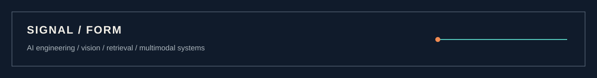

  

  <a href="#01--about">ABOUT</a> &nbsp;·&nbsp; <a href="#02--technical-universe">TECHNICAL UNIVERSE</a> &nbsp;·&nbsp; <a href="#03--selected-work">SELECTED WORK</a> &nbsp;·&nbsp; <a href="#04--public-activity">ACTIVITY</a> &nbsp;·&nbsp; <a href="mailto:danhnd.work@gmail.com">EMAIL</a> &nbsp;·&nbsp; <a href="https://www.linkedin.com/in/danh-nguyen-duc-79ba6432a/">LINKEDIN</a>

 

## 01 / About

I’m **Danh**, a Computer Science student at **UIT, VNU-HCM**. My work sits where data becomes a system someone can actually use: checking imperfect annotations before training a detector, finding the right legal passage before generating an answer, and evaluating what the model missed.

I’m preparing for a **Fresher AI Engineer** role. I like the part of engineering that happens after the first demo: tracing errors, improving the data, and making a result reproducible. I’ve also explored multilingual video retrieval through a first-author research project.

`Ho Chi Minh City, Vietnam` &nbsp;·&nbsp; `B.Sc. Computer Science, expected 2027`

 

## 02 / Technical universe

**Perception** · PyTorch, OpenCV, YOLO, Transformers &nbsp; / &nbsp; **Retrieval** · Python, SQL, LightGBM, reranking &nbsp; / &nbsp; **Delivery** · FastAPI, Docker, Git, Linux, ONNX

 

## 03 / Selected work

Hybrid retrieval over Vietnamese legal documents, followed by learning to rank and reranking. <a href="https://github.com/ducdanh2304/lexviet-retrieval">Explore LexViet →</a>

YOLOv8n with model-assisted annotation review and reproducible inference. <a href="https://github.com/ducdanh2304/3lc-vehicle-detection-1st-place">Explore detection →</a>

Question answering for the 2019 Labor Code with query rewriting and semantic routing. <a href="https://github.com/ducdanh2304/vietnam-labor-law-rag">Explore Labor Law RAG →</a>

Multi-Vehicle Detection placed <a href="https://www.kaggle.com/competitions/3-lc-multi-vehicle-detection-challenge">1st in the 3LC Challenge</a>. Project artwork is linked to each repository.

 

## 04 / Public activity

Shows public events returned by GitHub’s API. The <a href="https://github.com/ducdanh2304?tab=overview">contribution graph</a> contains the fuller history.

 

<a href="mailto:danhnd.work@gmail.com">Email</a> &nbsp;·&nbsp; <a href="https://www.linkedin.com/in/danh-nguyen-duc-79ba6432a/">LinkedIn</a> &nbsp;·&nbsp; <a href="https://facebook.com/nguyen.shari.7/">Facebook</a> &nbsp;·&nbsp; <a href="https://github.com/ducdanh2304?tab=repositories">All repositories</a>

