<!-- SECTION 01 — HERO / INTRODUCTION -->

  

  

  &nbsp;&nbsp;&nbsp;

 

<!-- SECTION 02 — ABOUT ME -->
## `01 //` Engineering Profile

<table>
  <tr>
    <td width="64%" valign="top">
      

        I am a Computer Science undergraduate at the <strong>University of Information Technology (UIT – VNUHCM)</strong> focused on building reliable, measurable AI systems across <strong>Computer Vision</strong>, <strong>Natural Language Processing</strong>, and <strong>Multimodal Retrieval</strong>.
      

      

        My engineering workflow spans the full lifecycle—from data auditing, structure-aware chunking, and multi-signal retrieval pipelines to parameter-efficient fine-tuning, multi-GPU inference sharding, and latency optimization. Rather than treating models in isolation, I focus on data quality, deterministic evaluation, and reproducible system architecture.
      

    </td>
    <td width="36%" valign="top">
      <table>
        <tr>
          <td><strong>Target Roles</strong></td>
          <td>Fresher AI / ML Engineer</td>
        </tr>
        <tr>
          <td><strong>Core Focus</strong></td>
          <td>CV, NLP, Multimodal & IR</td>
        </tr>
        <tr>
          <td><strong>Institution</strong></td>
          <td>UIT – VNUHCM (2027)</td>
        </tr>
        <tr>
          <td><strong>Academics</strong></td>
          <td>GPA 8.61/10 · IELTS 6.5</td>
        </tr>
      </table>
    </td>
  </tr>
</table>

 

<!-- SECTION 03 — CAREER HIGHLIGHTS -->
## `02 //` Verified Milestones & Competitions

<table>
  <tr>
    <td width="50%" valign="top">
      <h3><code>01</code> &nbsp;1st Place — 3LC Multi-Vehicle Detection</h3>
      

        <strong>2026 &nbsp;·&nbsp; Computer Vision & Data-Centric AI</strong> 
        Achieved <strong>0.95099 Public / 0.94052 Private mAP@0.5</strong> by combining model-assisted label auditing across 61 dataset revisions with YOLOv8n training and NMS tuning. 
        <a href="https://github.com/ducdanh2304/3lc-vehicle-detection-2nd-place">→ Inspect Solution Repository</a>
      

    </td>
    <td width="50%" valign="top">
      <h3><code>02</code> &nbsp;First Author — Springer Publication</h3>
      

        <strong>2026 &nbsp;·&nbsp; Multimodal Information Retrieval (SOICT)</strong> 
        Published peer-reviewed research on efficient Vietnamese-English semantic video search scaling across 1,478 videos (~600k keyframes) via multi-modal fusion. 
        <a href="https://link.springer.com/chapter/10.1007/978-981-92-2597-2_36">→ Read Chapter on SpringerLink</a>
      

    </td>
  </tr>
  <tr>
    <td width="50%" valign="top">
      <h3><code>03</code> &nbsp;Top 5 Finalist — HCMC AI Challenge</h3>
      

        <strong>2025 &nbsp;·&nbsp; Large-Scale Video Event Retrieval</strong> 
        Placed in the <strong>Top 5 out of 600+ competing teams</strong>, architecting a real-time multi-modal retrieval and dynamic temporal alignment engine for 300+ hours of broadcast footage.
      

    </td>
    <td width="50%" valign="top">
      <h3><code>04</code> &nbsp;Top 19 — UIT Data Science Challenge</h3>
      

        <strong>2026 &nbsp;·&nbsp; Task 1: Legal Information Retrieval</strong> 
        Engineered an 11-signal hybrid retrieval and two-stage LambdaMART + Jina reranking pipeline over 596,062 Vietnamese statutory provisions (<strong>94.28% Recall@5</strong>).
      

    </td>
  </tr>
</table>

 

<!-- SECTION 04 — TECHNICAL EXPERTISE -->
## `03 //` Technical Stack & Capabilities

<table>
  <tr>
    <td width="33%" valign="top">
      <strong>Languages & Scripting</strong>  
        
      <code>Python</code> &nbsp;<code>SQL</code> &nbsp;<code>Bash</code>
    </td>
    <td width="33%" valign="top">
      <strong>ML & Deep Learning</strong>  
        
      <code>PyTorch</code> &nbsp;<code>HF Transformers</code> &nbsp;<code>LightGBM</code> &nbsp;<code>Scikit-learn</code> &nbsp;<code>YOLO</code> &nbsp;<code>PEFT</code> &nbsp;<code>LoRA / QLoRA</code>
    </td>
    <td width="33%" valign="top">
      <strong>CV, NLP & Retrieval</strong>  
        
      <code>OpenCV</code> &nbsp;<code>Object Detection</code> &nbsp;<code>OCR</code> &nbsp;<code>Dense Retrieval</code> &nbsp;<code>Information Retrieval</code> &nbsp;<code>Reranking</code>
    </td>
  </tr>
  <tr>
    <td width="33%" valign="top">
      <strong>Data Engineering</strong>  
        
      <code>NumPy</code> &nbsp;<code>Pandas</code> &nbsp;<code>SQLite</code>
    </td>
    <td width="33%" valign="top">
      <strong>Backend & Deployment</strong>  
        
      <code>FastAPI</code> &nbsp;<code>Docker</code> &nbsp;<code>GitHub Actions</code> &nbsp;<code>ONNX</code> &nbsp;<code>TensorRT</code>
    </td>
    <td width="33%" valign="top">
      <strong>Systems & Tooling</strong>  
        
      <code>Git</code> &nbsp;<code>Linux</code>
    </td>
  </tr>
</table>

 

<!-- SECTION 05 — FEATURED PROJECTS -->
## `04 //` Featured Engineering Systems

### `PROJECT A` &nbsp;LexViet — Vietnamese Legal Document Retrieval
> **Domain:** Legal Information Retrieval · Hybrid Search · Multi-Stage Reranking  
> **Repository:** [`github.com/ducdanh2304`](https://github.com/ducdanh2304) *(Verify exact repository slug on GitHub)*

A Vietnamese statutory retrieval architecture built to surface exact legal provisions in response to complex natural-language queries across **596,062 indexed legal chunks**.

  

* **Structure-Aware Chunking:** Built a three-tier parser preserving Vietnamese legal hierarchies (*Chapter → Article → Clause*) with token-level fallback splitting.
* **11-Signal Hybrid Fusion:** Combined dense embeddings, lexical retrieval, memory signals, and structural graph features via weighted Reciprocal Rank Fusion (RRF).
* **Two-Stage Reranking & Distributed Caching:** Cascaded **LightGBM LambdaMART** with six-view **Jina reranking**, backed by a resumable SQLite cache storing **748,800** query-document-view scores across 3-GPU shards with deterministic merging and SHA-256 integrity checks.
* **Verified Evaluation:** **96.35% Recall@60** and **94.28% Recall@5** across 2,080 private queries; improved 5-fold out-of-fold Top-5 hits from `466 → 475`.

`Python` · `PyTorch` · `Hugging Face Transformers` · `LightGBM` · `SQLite` · `Dense Retrieval` · `Reranking`

---

### `PROJECT B` &nbsp;Multi-Vehicle Detection — 3LC Challenge (`1st Place`)
> **Domain:** Data-Centric Computer Vision · Object Detection · Inference Optimization  
> **Repository:** [`github.com/ducdanh2304/3lc-vehicle-detection-2nd-place`](https://github.com/ducdanh2304/3lc-vehicle-detection-2nd-place)

A data-centric object detection pipeline engineered to resolve severe annotation noise and missing bounding boxes in multi-class traffic imagery.

* **Model-Assisted Data Auditing:** Iteratively surfaced unlabeled and misclassified vehicle instances using error analysis, executing **61 dataset revisions** alongside **21 controlled training runs**.
* **Training & Augmentation Strategy:** Trained **YOLOv8n** from scratch for 250 epochs using SGD, cosine learning rate scheduling, and targeted Mosaic, MixUp, and Copy-Paste augmentations.
* **Post-Processing Calibration:** Tuned confidence thresholds and Non-Maximum Suppression (NMS) parameters to maximize precision-recall balance on dense traffic scenes.
* **Verified Leaderboard Results:** Ranked **1st Place** overall with **0.95099 mAP@0.5** (Public LB) and **0.94052 mAP@0.5** (Private LB).

`Python` · `PyTorch` · `YOLO` · `OpenCV` · `NumPy` · `Pandas`

---

### `PROJECT C` &nbsp;Efficient Video Retrieval for Less-Resourced Languages (`First Author`)
> **Domain:** Multimodal Semantic Search · Cross-Lingual Retrieval · Temporal Alignment  
> **Publication:** [`Springer — Information and Communication Technology (SOICT)`](https://link.springer.com/chapter/10.1007/978-981-92-2597-2_36)

An end-to-end multimodal video event retrieval system designed for Vietnamese queries over large-scale unscripted video archives, validated in the **HCMC AI Challenge 2025 Final Round (Top 5 / 600+ teams)**.

* **Multi-Stream Feature Extraction:** Integrated **CLIP**, **BEiT-3**, and **MetaCLIP-2** for visual-semantic embeddings, **Co-DETR** for fine-grained object detection, **Vintern-3B** for scene OCR, **EraX-VL-2B-V1.5** for Vietnamese keyframe captioning, and **Whisper** for automatic speech recognition.
* **Temporal Event Alignment:** Formulated multi-frame query matching using **Log-Sum-Exp** score aggregation and **Dynamic Programming** to localize sequential events across continuous video timelines.
* **Verified Corpus Scale:** Indexed and searched **1,478 videos** spanning **300+ hours** and approximately **600,000 keyframes**.

`Python` · `PyTorch` · `CLIP` · `BEiT-3` · `Whisper` · `VLM / OCR` · `Information Retrieval`

 

<!-- SECTION 06 — RESEARCH & PUBLICATIONS -->
## `05 //` Research & Publications

<table>
  <tr>
    <td valign="top">
      <strong>Efficient Video Retrieval for Less-Resourced Languages via Multi-Modal Semantic Search</strong> 
      <strong>Role:</strong> First Author &nbsp;·&nbsp; <strong>Venue:</strong> International Symposium on Information and Communication Technology (SOICT) — <em>Springer Nature Singapore</em> (2026) &nbsp;·&nbsp; <strong>DOI:</strong> <code>10.1007/978-981-92-2597-2_36</code>
      

        Addresses the semantic and linguistic gap in low-resource video retrieval by uniting dual-encoder vision-language representations with localized Vietnamese OCR, generated frame captions, ASR transcripts, and dynamic programming temporal search.
      

      

        <strong>Focus Areas:</strong> <code>Multimodal Retrieval</code> &nbsp;<code>Low-Resource NLP</code> &nbsp;<code>Temporal Alignment</code> &nbsp;<code>Vision-Language Fusion</code> 
        <a href="https://link.springer.com/chapter/10.1007/978-981-92-2597-2_36"><strong>→ Access Published Chapter on SpringerLink</strong></a>
      

    </td>
  </tr>
</table>

 

<!-- SECTION 07 — GITHUB ACTIVITY -->
## `06 //` Engineering Activity

  <!-- Contribution Snake generated via GitHub Action (.github/workflows/snake.yml) -->
  <picture>
    <source media="(prefers-color-scheme: dark)" srcset="https://raw.githubusercontent.com/ducdanh2304/ducdanh2304/output/github-contribution-grid-snake-dark.svg" />
    <source media="(prefers-color-scheme: light)" srcset="https://raw.githubusercontent.com/ducdanh2304/ducdanh2304/output/github-contribution-grid-snake.svg" />
    
  </picture>

 

  

 

<!-- SECTION 08 — CONNECT WITH ME -->
## `07 //` Connect

  Always interested in building meaningful AI systems and collaborating on challenging engineering problems.

  
  
  

