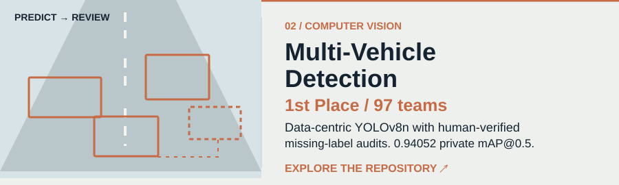
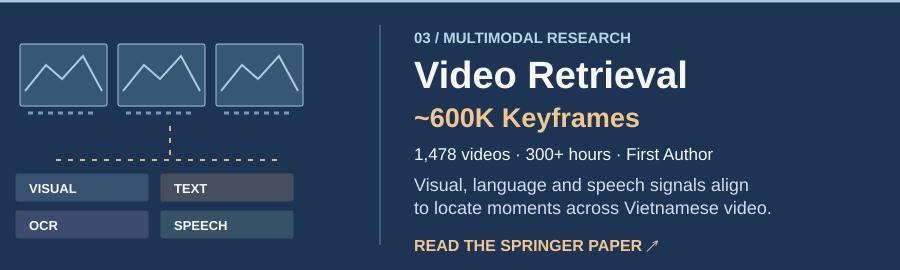

  
  
  
  

<strong>Vision. Language. Retrieval.</strong> Building intelligent systems through data, representation learning and careful evaluation.

## Technical Toolkit

### Programming

 <strong>Python</strong> &nbsp;&nbsp;&nbsp;  <strong>Bash</strong> &nbsp;&nbsp;&nbsp; <strong>SQL</strong>

### Machine Learning

 <strong>PyTorch</strong> &nbsp;&nbsp;&nbsp; 🤗 <strong>Transformers</strong> &nbsp;&nbsp;&nbsp;  <strong>Scikit-learn</strong>

LightGBM · YOLO · PEFT (LoRA / QLoRA)

### Computer Vision & NLP

 <strong>OpenCV</strong> &nbsp;&nbsp;&nbsp; Object detection · OCR · Information retrieval · Dense retrieval · Reranking

### Data & Engineering

 <strong>NumPy</strong> &nbsp;&nbsp;&nbsp;  <strong>Pandas</strong> &nbsp;&nbsp;&nbsp;  <strong>SQLite</strong> &nbsp;&nbsp;&nbsp;  <strong>Git</strong> &nbsp;&nbsp;&nbsp;  <strong>Linux</strong>

### Deployment

 <strong>FastAPI</strong> &nbsp;&nbsp;&nbsp;  <strong>Docker</strong> &nbsp;&nbsp;&nbsp;  <strong>GitHub Actions</strong> &nbsp;&nbsp;&nbsp; ONNX · TensorRT

## Selected Work

<a href="https://github.com/ducdanh2304/lexviet-retrieval"><picture><source media="(max-width: 600px)" srcset="https://raw.githubusercontent.com/ducdanh2304/ducdanh2304/8ea76ce9d0c943f9a68cff85ded522e7fc7b9b7d/assets/lexviet-mobile.svg" /></picture></a>

<a href="https://github.com/ducdanh2304/3lc-vehicle-detection-1st-place"><picture><source media="(max-width: 600px)" srcset="https://raw.githubusercontent.com/ducdanh2304/ducdanh2304/8ea76ce9d0c943f9a68cff85ded522e7fc7b9b7d/assets/detection-mobile.svg" /></picture></a>

<a href="https://link.springer.com/chapter/10.1007/978-981-92-2597-2_36"><picture><source media="(max-width: 600px)" srcset="https://raw.githubusercontent.com/ducdanh2304/ducdanh2304/8ea76ce9d0c943f9a68cff85ded522e7fc7b9b7d/assets/video-mobile.svg" /></picture></a>

<strong>Published research</strong> · <a href="https://link.springer.com/chapter/10.1007/978-981-92-2597-2_36">Efficient Video Retrieval for Less-Resourced Languages via Multi-modal Semantic Search</a> · First Author · SOICT 2025 · Springer Nature · 2026

## Recognition

**1st Place** / 3LC Multi-Vehicle Detection &nbsp;&nbsp; · &nbsp;&nbsp; **Top 19** / UIT Data Science Challenge &nbsp;&nbsp; · &nbsp;&nbsp; **Top 5** / HCMC AI Challenge 2025

<strong>Building systems. Measuring results. Improving what matters.</strong>

