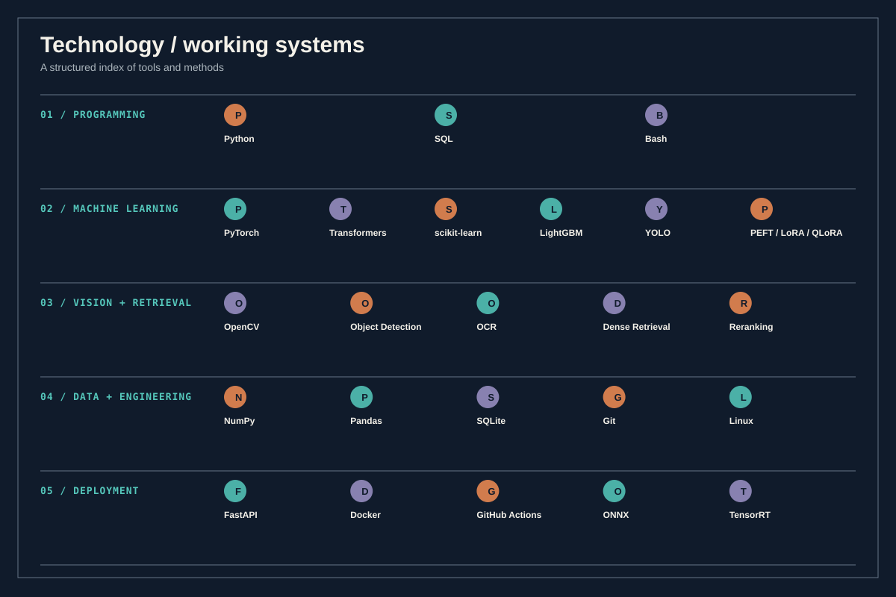
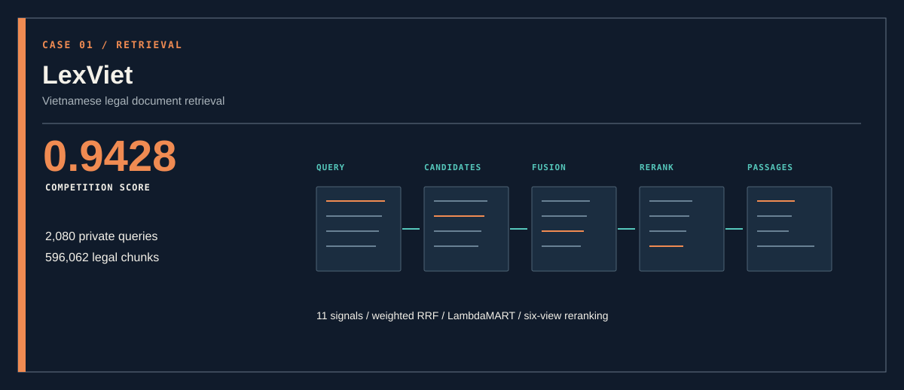
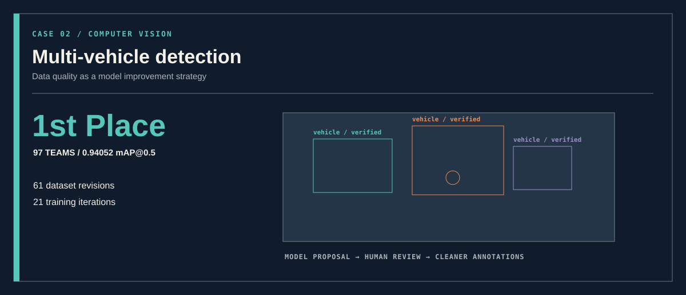
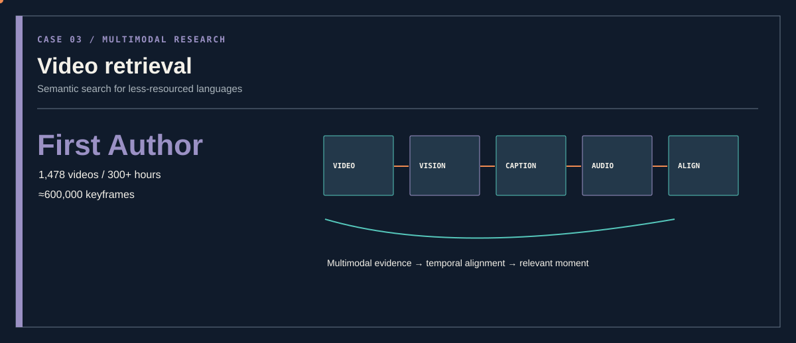

I build retrieval and vision systems that turn complex data into useful signals. My work spans legal search, data-centric object detection, and multilingual video retrieval.

<a href="https://github.com/ducdanh2304/lexviet-retrieval">Legal retrieval</a> &nbsp;·&nbsp; <a href="https://github.com/ducdanh2304/3lc-vehicle-detection-1st-place">Computer vision</a> &nbsp;·&nbsp; <a href="https://link.springer.com/chapter/10.1007/978-981-92-2597-2_36">Research paper</a>

## Working systems

The index includes tools I use and methods I work with. PEFT, LoRA, QLoRA, detection, OCR, and retrieval are methods rather than software logos.

## Selected work

### 01 / LexViet

An 11-signal hybrid pipeline combines dense and lexical search, weighted reciprocal rank fusion, two-stage LightGBM LambdaMART, and six-view Jina reranking. A resumable SQLite scoring cache and deterministic three-GPU sharding support large-scale evaluation. [Explore the repository →](https://github.com/ducdanh2304/lexviet-retrieval)

### 02 / Multi-vehicle detection

YOLOv8n trained from random initialization for 250 epochs. Model-assisted missing-label auditing with human verification drove 61 dataset revisions and 21 training iterations. Mosaic, MixUp, confidence threshold, and NMS tuning completed the pipeline. [Explore the repository →](https://github.com/ducdanh2304/3lc-vehicle-detection-1st-place)

### 03 / Multimodal video retrieval

Visual embeddings, Vietnamese captions, OCR, speech, and temporal alignment connect natural-language queries to video moments. The system explores CLIP, BEiT-3, MetaCLIP-2, EraX-VL, Vintern, Co-DETR, and Whisper with Log-Sum-Exp aggregation and dynamic programming. [Read the paper →](https://link.springer.com/chapter/10.1007/978-981-92-2597-2_36)

## Research & recognition

**Publication** · First author · [Efficient Video Retrieval for Less-Resourced Languages via Multi-modal Semantic Search](https://link.springer.com/chapter/10.1007/978-981-92-2597-2_36). *SOICT 2025; published online 2026.*

| Recognition | Context |
| :-- | :-- |
| **1st Place** | 3LC Multi-Vehicle Detection Challenge · 97 teams |
| **Top 19** | UIT Data Science Challenge · legal information retrieval |
| **Top 5 / Consolation Prize** | Ho Chi Minh City AI Challenge 2025 · 600+ teams |

<a href="https://www.linkedin.com/in/danh-nguyen-duc-79ba6432a/">LinkedIn</a> &nbsp;·&nbsp; <a href="mailto:danhnd.work@gmail.com">Email</a> &nbsp;·&nbsp; <a href="https://github.com/ducdanh2304">GitHub</a>

