<!-- SECTION 01 — HERO / INTRODUCTION -->

  

  

  &nbsp;
  &nbsp;
  &nbsp;
  

---

### 
💡 About Me

  👋 Hi! I am a Computer Science student at <b>UIT - VNUHCM</b>. I love building practical deep learning systems and solving hard machine learning challenges. 
   
  🚀 My main focus areas are <b>Computer Vision</b>, <b>NLP & Information Retrieval</b>, and <b>Multimodal AI</b>. I enjoy working on data-centric optimization, fine-tuning modern models, and building robust pipelines. I also love testing my skills in competitive ML and coding arenas.

 

---

### 
🛠️ Technical Arsenal

  
<b>Languages & Core Systems</b>

  &nbsp;
  &nbsp;
  &nbsp;
  &nbsp;
  

   

  
<b>Machine Learning & Deep Learning Frameworks</b>

  &nbsp;
  &nbsp;
  &nbsp;
  &nbsp;
  

   

  
<b>Computer Vision, NLP & Retrieval</b>

  &nbsp;
  &nbsp;
  &nbsp;
  &nbsp;
  

   

  
<b>Deployment, MLOps & Hardware</b>

  &nbsp;
  &nbsp;
  &nbsp;
  &nbsp;
  

---

---

### 
🚀 Featured AI & ML Projects

 

  <table>
    <tr>
      <td width="50%" valign="top" style="background-color: #0F172A; border: 1px solid #334155; border-radius: 12px; padding: 20px;">
        <h3>⚖️ LexViet — Legal Document Retrieval</h3>
        

          An advanced information retrieval pipeline for Vietnamese legal texts. Built with a robust hybrid retrieval architecture combining dense embeddings, sparse retrieval, and multi-stage reranking to achieve high precision on complex legal queries.
        

        

          <b>Tech Stack:</b> 
          &nbsp;
          &nbsp;
          &nbsp;
          
        

        

          
        

      </td>
      <td width="50%" valign="top" style="background-color: #0F172A; border: 1px solid #334155; border-radius: 12px; padding: 20px;">
        <h3>🚗 Multi-Vehicle Detection Challenge</h3>
        

          A high-performance computer vision solution for multi-class vehicle detection. Focused on data-centric error inspection, label auditing, and rigorous optimization to maximize mAP metrics under challenging real-world occlusion conditions.
        

        

          <b>Tech Stack:</b> 
          &nbsp;
          &nbsp;
          &nbsp;
          
        

        

          
        

      </td>
    </tr>
  </table>

