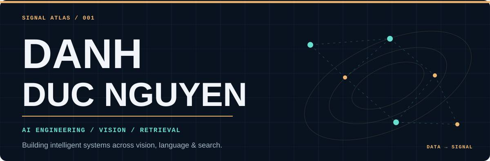

  
  
  
  

<strong>AI ENGINEERING · COMPUTER VISION · INFORMATION RETRIEVAL · MULTIMODAL AI</strong> Building intelligent systems through data, representation learning and retrieval.

---

## Technical Toolkit

**Software & platforms**

   <strong>Python</strong> &nbsp;&nbsp;
   <strong>PyTorch</strong> &nbsp;&nbsp;
   <strong>OpenCV</strong> &nbsp;&nbsp;
   <strong>Scikit-learn</strong> &nbsp;&nbsp;
   <strong>NumPy</strong>

   <strong>Pandas</strong> &nbsp;&nbsp;
   <strong>SQLite</strong> &nbsp;&nbsp;
   <strong>FastAPI</strong> &nbsp;&nbsp;
   <strong>Docker</strong> &nbsp;&nbsp;
   <strong>Git</strong> &nbsp;&nbsp;
   <strong>Linux</strong>

**Methods & competencies**  
Hybrid and dense retrieval · Learning to rank · Reranking · Object detection · OCR · Multimodal search

Also working with Hugging Face Transformers, LightGBM, YOLO, PEFT (LoRA / QLoRA), SQL, Bash, GitHub Actions, ONNX and TensorRT.

---

## Selected Work

---

## Research & Publication

**Efficient Video Retrieval for Less-Resourced Languages via Multi-modal Semantic Search**

First Author · SOICT 2025 · Springer Nature · Published 2026  
[Read the published paper ↗](https://link.springer.com/chapter/10.1007/978-981-92-2597-2_36)

---

## Recognition

- **1st Place** · [3LC Multi-Vehicle Detection Challenge](https://github.com/ducdanh2304/3lc-vehicle-detection-1st-place), 97 teams
- **Top 19** · UIT Data Science Challenge, Legal Information Retrieval
- **Top 5 · Consolation Prize** · Ho Chi Minh City AI Challenge 2025, 600+ teams

---

<strong>Building systems. Measuring results. Improving what matters.</strong> <a href="mailto:danhnd.work@gmail.com">Email</a> · <a href="https://www.linkedin.com/in/danh-nguyen-duc-79ba6432a/">LinkedIn</a> · <a href="https://github.com/ducdanh2304?tab=repositories">Repositories</a>

